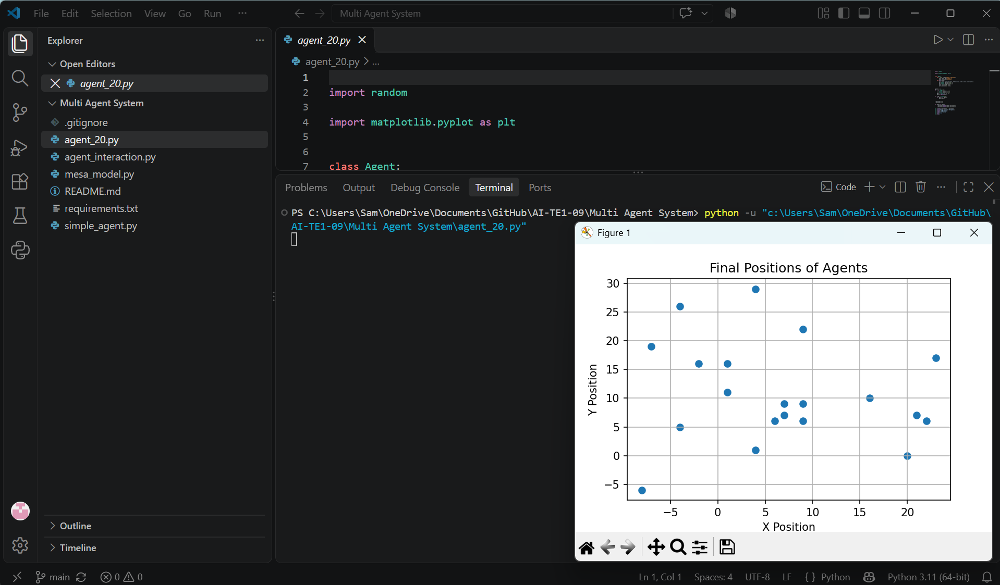
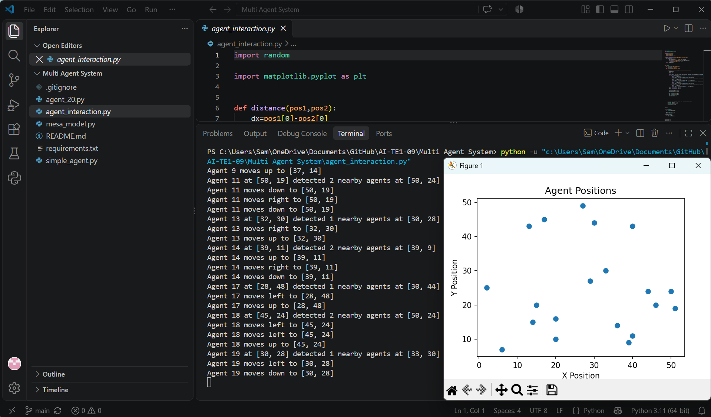
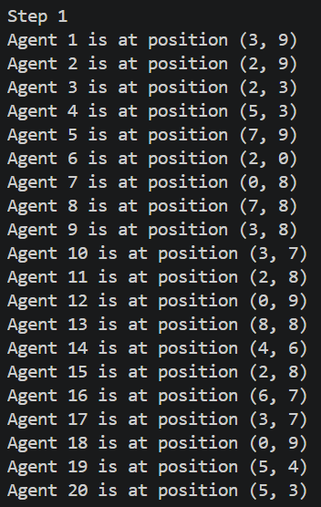
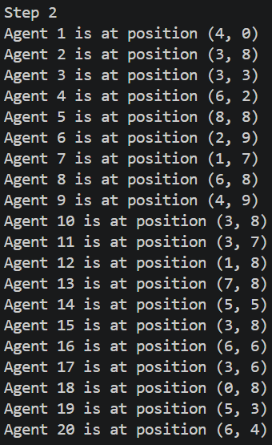
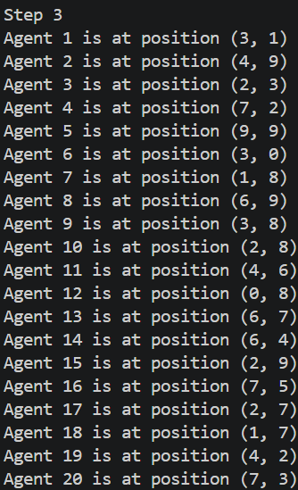
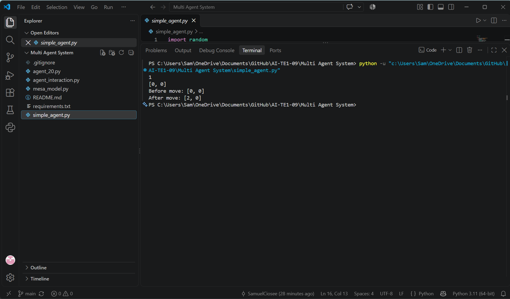

# Introduction

Multi Agent System (Sistem Multi-Agen) adalah sistem yang terdiri dari beberapa agen yang bergerak atau bertindak secara mandiri dalam suatu lingkungan. Setiap agen dapat mengikuti aturan tertentu, dan pada beberapa simulasi juga dapat berinteraksi dengan agen lain.

Folder ini berisi beberapa contoh simulasi multi-agent menggunakan Python:

- `simple_agent.py`: contoh dasar dengan satu agen yang bergerak secara acak.
- `agent_20.py`: 20 agen bergerak secara acak selama 100 langkah, kemudian posisi akhirnya ditampilkan dalam grafik.
- `agent_interaction.py`: 20 agen mendeteksi agen lain dalam jarak tertentu, mencoba menyesuaikan gerakannya, lalu menampilkan posisi agen dalam grafik. Pada kode saat ini, gerakan acak juga dijalankan setelah logika tersebut.
- `mesa_model.py`: simulasi 20 agen pada grid menggunakan framework Mesa. Agen bergerak ke salah satu sel tetangga dan posisi mereka dicetak untuk tiga langkah simulasi.

Sumber Kode : https://github.com/BesircanB/mesa-agent-simulation

# Requirement

1. Python 3.11 atau versi Python yang kompatibel
2. Instal library yang diperlukan:
   - matplotlib
   - mesa
   - networkx

# How To Use

1. Buka terminal pada folder `Multi Agent System`.
2. Pastikan seluruh library sudah terinstal menggunakan perintah pada bagian Requirement.
3. Jalankan salah satu program sesuai simulasi yang ingin dicoba:

   ```powershell
   python simple_agent.py
   python agent_20.py
   python agent_interaction.py
   python mesa_model.py
   ```

4. Untuk `agent_20.py` dan `agent_interaction.py`, program menampilkan grafik posisi agen; `agent_interaction.py` juga mencetak informasi deteksi dan gerakan ke terminal. Untuk `simple_agent.py` dan `mesa_model.py`, hasil pergerakan ditampilkan di terminal.

# Running/Result

Setiap program menunjukkan hasil yang dapat berbeda pada setiap eksekusi karena pergerakan agen menggunakan pilihan acak.

- `agent_20.py` menampilkan grafik posisi akhir dari 20 agen setelah 100 langkah.

  

- `agent_interaction.py` menampilkan log interaksi di terminal dan grafik posisi agen setelah satu putaran. Setiap agen diproses sekali per putaran, tetapi fungsi geraknya dapat mengubah posisi dua kali karena gerakan acak tambahan.

  

- `mesa_model.py` menampilkan posisi 20 agen setelah masing-masing dari tiga langkah simulasi.

  **Step 1**

  

  **Step 2**

  

  **Step 3**

  

- `simple_agent.py` menampilkan ID dan posisi satu agen sebelum dan sesudah bergerak.

  
