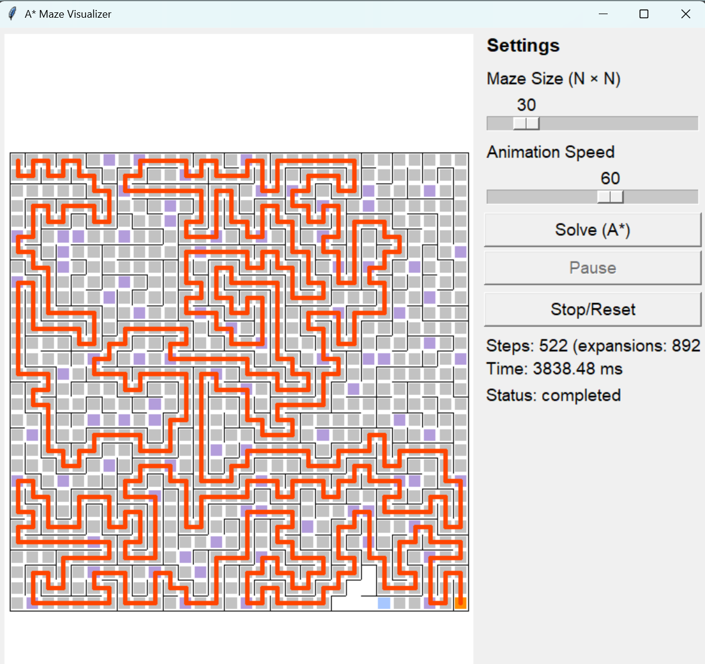
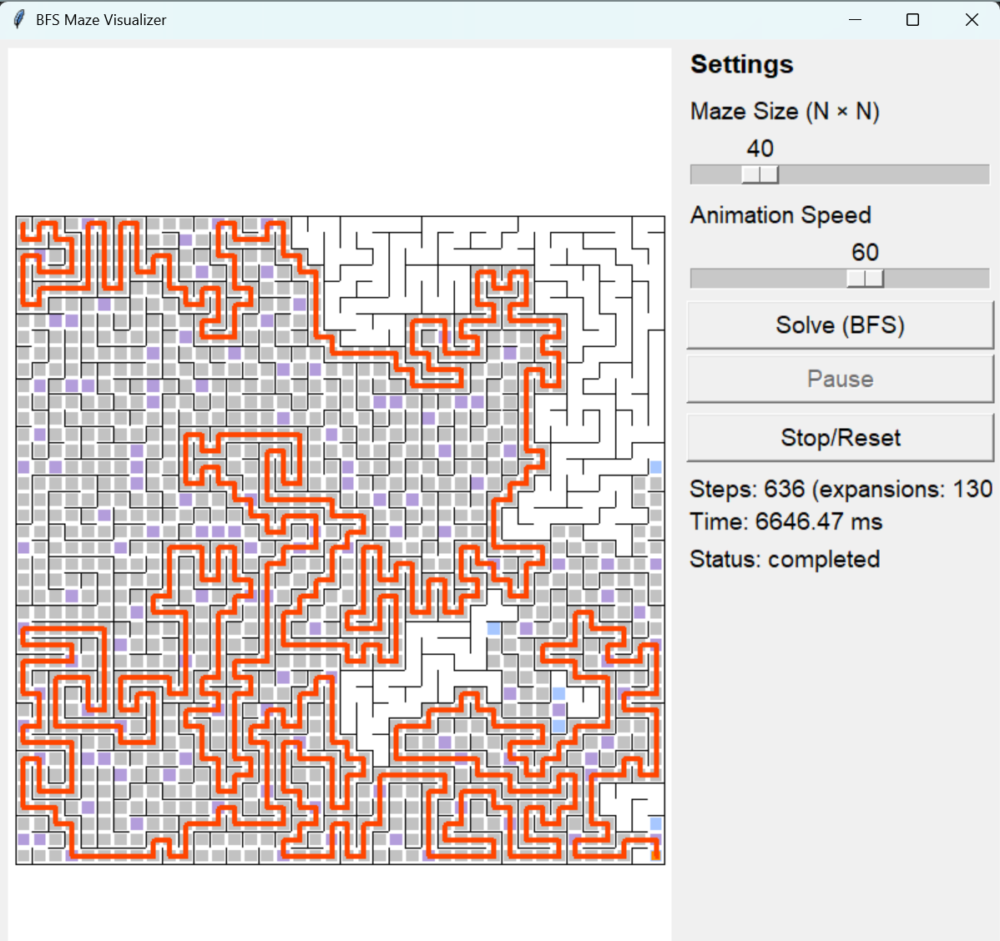
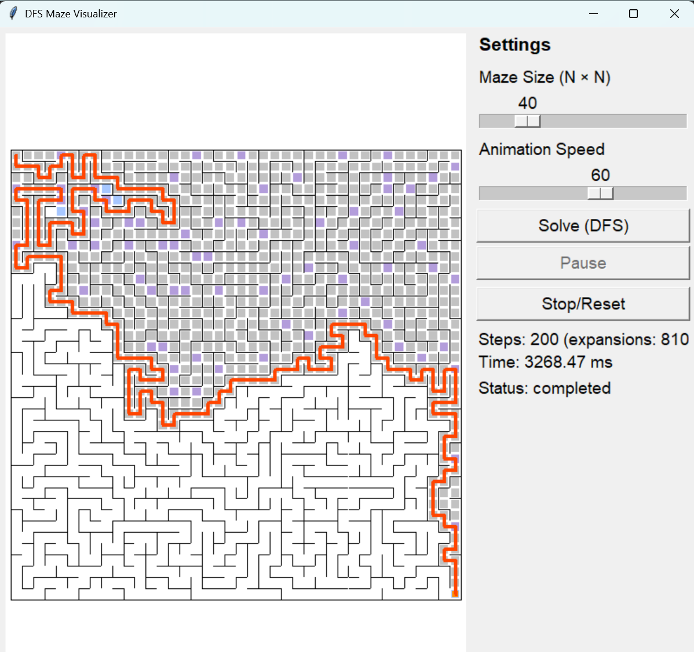

# Introduction

Searching Algorithm (Algoritma Pencarian) adalah kumpulan metode untuk menemukan jalur dari titik awal menuju tujuan. Proyek ini menampilkan proses pencarian jalur pada labirin acak secara visual, sehingga cara kerja setiap algoritma dapat diamati dan dibandingkan.

Tersedia tiga algoritma:

1. **A_star** menelusuri dengan menggabungkan jarak yang sudah ditempuh dan tebakan arah terdekat. Pada labirin ini, A* menemukan jalur paling optimal dan efisien dengan cepat.
2. **Breadth-First Search (BFS)** menelusuri selangkah demi selangkah dari titik awal. Pada labirin ini, BFS menemukan jalur dengan jumlah langkah paling sedikit.
3. **Depth-First Search (DFS)** menelusuri satu cabang sedalam mungkin sebelum mencoba cabang lain.

Setiap program membuat labirin acak dan menampilkan animasi pencarian dari titik awal ke tujuan.

Sumber Kode : https://github.com/ziaihsan/Pathfinder-Visualization

# Requirement

1. Python 3
2. Tkinter 

# How To use

1. Buka terminal di folder `Searching Algorithm`.
2. Jalankan salah satu program
3. Atur ukuran labirin dan kecepatan animasi melalui slider. Ukuran awal adalah 40 × 40; ukuran labirin dibatasi dari 2 hingga 200 sel per sisi.
4. Klik **Solve** untuk membuat labirin acak dan menjalankan algoritma yang dipilih.
5. Gunakan **Pause** untuk menjeda atau melanjutkan animasi, dan **Stop/Reset** untuk menghentikan atau mengatur ulang tampilan.

# Running/Result

Berikut adalah hasil visualisasi dari setiap algoritma:
### A star

### BFS

### DFS

